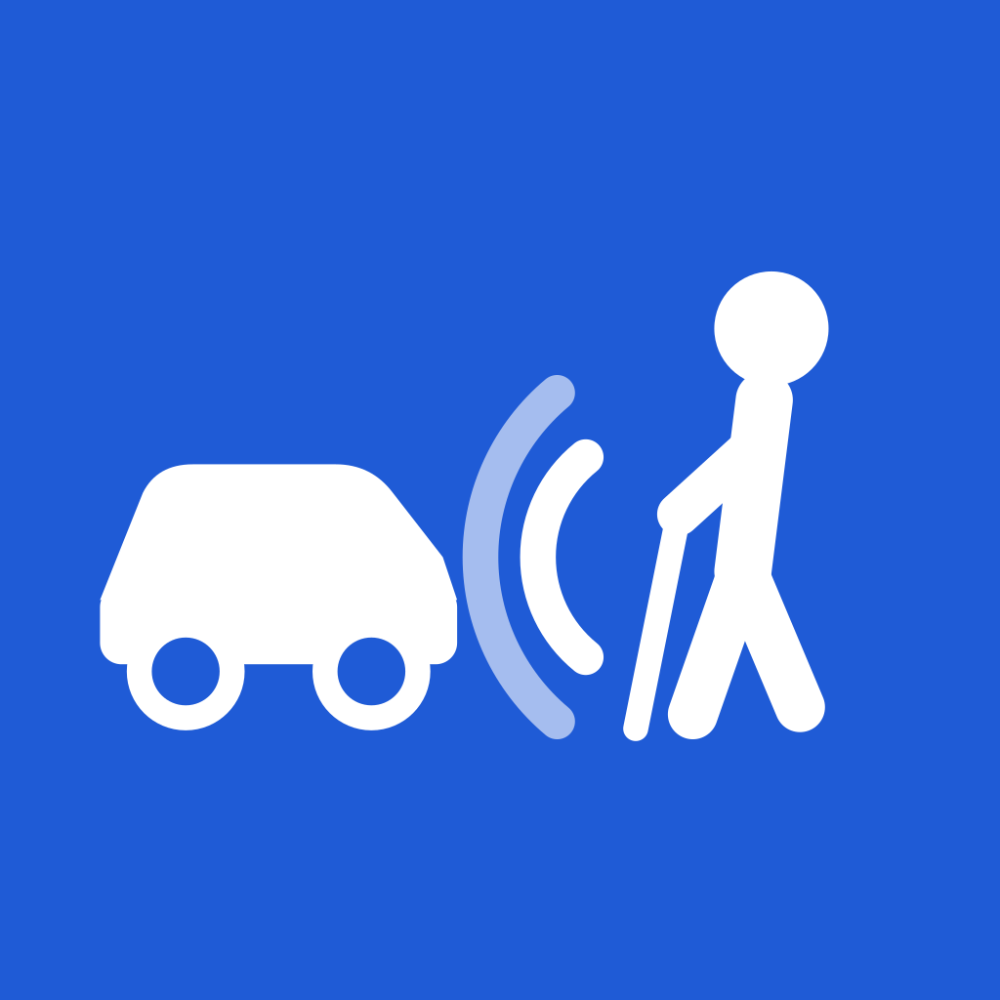
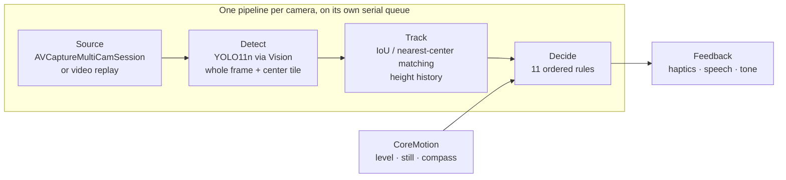

<p align="center">
  
</p>

<h1 align="center">Streetify</h1>

<p align="center">
  An on-device iOS app that helps blind and low-vision pedestrians judge traffic at crossings with no signal.<br>
  Built at CalHacks.
</p>

---

## The problem

At an unsignalized crossing there is no walk light and no accessible pedestrian signal. A blind traveler has to judge gaps in traffic by ear, and quiet cars (EVs and hybrids) make that much harder.

## What it does

The user stands at the curb and holds the iPhone sideways with the cameras toward the street. The **front and back cameras run at the same time**, so the phone watches the road in both directions. For each side it reports one of three states:

| State | Meaning | Example |
|---|---|---|
| **Approaching** | A vehicle is coming, with an estimated time to arrival | "Right: car, 6 seconds" |
| **Clear** | The road was seen and nothing is coming | "Left: no cars" |
| **Unknown** | The app can't tell, and says why | "Left: blocked", "Hold still", "Turn the phone around" |

Output is non-visual: a distinct **haptic** pattern for each situation, a short **spoken** sentence when something changes, and an **audio tone** that guides the user to hold the phone level. All processing stays on the phone. There is no network and no server.

## Safety by design

This is a safety-critical app, so a few rules are enforced in code and covered by unit tests:

1. **It never says "safe", "go" or "cross now".** It reports only what it sees, and a unit test fails if any banned phrase appears in a user-facing string.
2. **Every failure ends in Unknown, never Clear.** Camera stalls, low light, a covered lens, a tilted phone, the user walking, thermal shutdown and missing permissions all report Unknown with a reason. The app also starts in Unknown.
3. **It errs toward false alarms.** "Clear" requires recent proof that the camera can see a working road (a moving vehicle seen in the last 5 minutes), not just an empty picture.

## How it works



- **Detect:** YOLO11n (CoreML) runs through Vision twice per frame: once on the whole frame and once on a 640×640 center tile where distant cars appear small. The two sets of boxes are merged. Orientation is passed to Vision as EXIF, so pixels are never rotated.
- **Track:** Boxes are matched across frames by IoU, falling back to nearest center. Each track keeps 1.5 s of box-height history.
- **Time to arrival:** `height / (dheight/dt)`, from a least-squares line fit. It uses box *height* because hand shake moves a box without resizing it, and viewing angle changes width but not height. A car counts as approaching when the fit's conservative bound (slope + 2 standard errors) gives under 20 s.
- **Decide:** The first of 11 ordered rules that fires wins: stale frames → phone moving → covered/dark/bright → approaching → not level → facing the user → misaimed → turned around → view blocked → no road seen → Clear (after a 1.5 s hold). Every threshold lives in one place, [`Config.swift`](GapCheck/Pipeline/Config.swift), with a one-line comment.
- **Feedback:** Each output channel has one job. The tone means "not aimed right", the speech queue is ordered by urgency (a close car outranks a car, which outranks a problem, which outranks "no cars"), and stale queued sentences are rebuilt from current state, so a car that has already passed is never announced late. With VoiceOver on, speech goes through VoiceOver announcements, so two voices never talk at once.

### Debug screen (for sighted judges)
A side-by-side view of both feeds, with YOLO11n-seg outlines tinted by threat (red = arriving soon, yellow = facing us, green = driving away) and a ConvNeXt front/rear orientation classifier, converted to CoreML from the [CFV model](https://github.com/fort-cyber/car-orientation). These models load only while the screen is visible, so they never cost a VoiceOver user battery or heat.

## Tech stack

| Area | Tools |
|---|---|
| Language / UI | Swift, SwiftUI, Observation |
| Camera | AVFoundation (`AVCaptureMultiCamSession` for simultaneous front + back capture) |
| ML inference | Vision, CoreML: YOLO11n (detection), YOLO11n-seg (outlines), ConvNeXt-small (car orientation, 8-bit quantized) |
| Sensors | CoreMotion (level, stillness, magnetic heading) |
| Feedback | CoreHaptics, AVAudioEngine (synthesized tone), AVSpeechSynthesizer / VoiceOver announcements |
| Model export | Python, Ultralytics, PyTorch, timm, coremltools |
| Build | XcodeGen (`project.yml`), Xcode, XCTest |

There are no third-party Swift dependencies. The app uses only Apple frameworks plus the bundled CoreML models.

## Testing

**136 XCTest cases** cover the logic that decides what the user hears:

- **Decide:** one test per rule, plus the initial-Unknown and never-Clear-on-failure invariants
- **Track:** matching, time-to-arrival math, and direction (approaching vs. driving away)
- **Feedback:** every state change produces the right vibration and sentence, no change produces nothing, and banned words never appear
- **Level / Detect:** the tilt hysteresis and the box merging
- **Clip / Footage:** recorded crossings replayed through the full pipeline to score how many seconds of warning each car got. These tests skip when the footage isn't present.

Rule and tracker tests feed in synthetic timestamped boxes. All timing uses frame timestamps rather than wall-clock time, so the tests are deterministic.

## Project layout

```
GapCheck/
  Capture/       FrameSource protocol, live multi-cam source, video replay source, level gate
  Pipeline/      Detect, Track, Decide, Config, orientation model
  Feedback/      Haptics, tone, speech queue, all user-facing strings
  DebugOverlay/  Visual screen for sighted judges, segmentation outlines
  AppModel.swift Session lifecycle, camera faults, wiring
GapCheckTests/   Unit, clip and footage tests
tools/           CoreML export script for the orientation model
docs/            Design specs and implementation plans
```

## Build and run

Requires Xcode, [XcodeGen](https://github.com/yonaskolb/XcodeGen), and an iPhone XS/XR or newer to run both cameras (the simulator runs the tests and the replay mode).

```bash
brew install xcodegen
```

Create `Local.xcconfig` (gitignored) with your signing team:

```
DEVELOPMENT_TEAM = YOUR_TEAM_ID
PRODUCT_BUNDLE_IDENTIFIER = com.yourname.streetify
```

```bash
xcodegen generate
```

```bash
xcodebuild -scheme GapCheck -destination 'platform=iOS Simulator,name=iPhone 17' -collect-test-diagnostics never test
```

The code, Xcode target and scheme still use the original working name, **GapCheck**.

## Status

This is a hackathon prototype. It has been through one on-device field test. That test led to a redesign: the app now judges only from the curb, uses a sideways hold, ignores cars driving away, and adds a "turn the phone around" check. Several behaviors are still untested on a real iPhone, including the compass checks, thermal behavior over long runs, and front-camera range.

**Streetify is not a mobility aid and must not replace a cane, a guide dog, or orientation and mobility training.**

## Team

Kevin Yin · Nathan Tien · Eric
